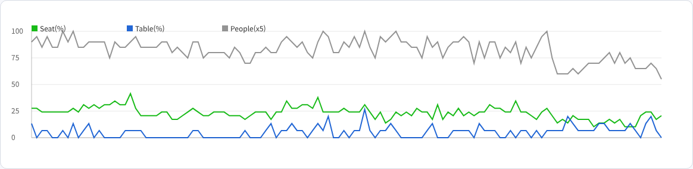
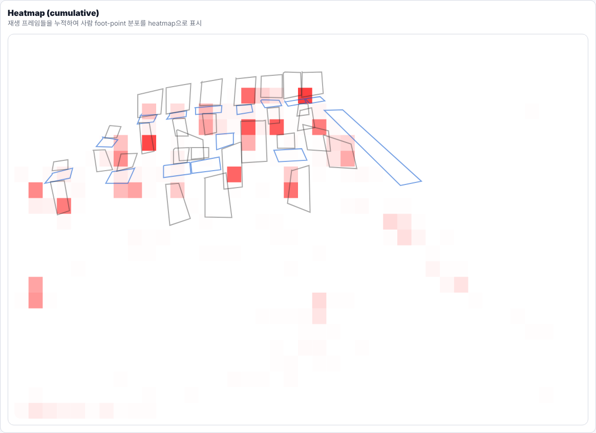

# 학식당 좌석 점유 분석 및 혼잡도 지표 설계

> 시각인지(Visual Perception) 기반 학식당 좌석 점유 분석 및 혼잡도 예측 기법 연구 — 2025 계절학기 4인 팀 프로젝트
> 원본 팀 저장소: [Visual-Perception-AIProject/cafeteria-seat-occupancy](https://github.com/Visual-Perception-AIProject/cafeteria-seat-occupancy)

학식당 CCTV 영상에서 사람을 검출하고(YOLOv8-L), 좌석·테이블 ROI와 결합해 **좌석/테이블 단위 점유 상태**를 판단한 뒤, 이를 시간 축으로 누적해 **혼잡도 지표**로 정량화·시각화한 프로젝트입니다.
이 저장소는 팀 프로젝트 중 **제가 담당한 점유 판단 알고리즘, 혼잡도 지표, 시각화 부분**을 중심으로 정리한 것입니다.

---

## 내 역할 (이윤슬)

| 담당 | 내용 | 위치 |
|---|---|---|
| 좌석 점유 판단 알고리즘 설계 | IoU 기반(Method A) / foot-point 기반(Method B) 점유 판단 설계 및 비교 | `tools/make_pred_occupancy.py` |
| 혼잡도 지표 정의 및 계산 모듈 | 좌석 점유율, 테이블 점유율, 인원 수를 결합한 혼잡도 점수·레벨, ROI별 점유 빈도 | `app.py` — `compute_rates_from_pred_frame`, `/api/metrics`, `/api/history`, `/api/heatmap_roi` |
| 시각화 모듈 | 누적 Timeline(좌석/테이블/인원), ROI 위 foot-point Heatmap | `templates/congestion.html` |
| 점유 Ground Truth | placeA·placeB 프레임별 좌석/테이블 점유 정답(`gt_occupancy.json`) 작성 | `data/places/*/gt_occupancy.json` |
| 결과보고서 | '혼잡도 분석, 시각화' 파트 집필 | [`docs/congestion_and_visualization.md`](docs/congestion_and_visualization.md) |

팀원 담당: YOLO 탐지 모델 학습·오류 분석(김소연), 라벨링·데이터셋 구축(박정현), 웹 대시보드 통합·시계열 예측·발표(이민영)

---

## 전체 파이프라인

```
영상 → 프레임 분할 → YOLOv8-L(미세조정) 사람 검출
     → ROI(좌석·테이블 polygon)와 결합 → 프레임별 점유 판단 (Method A / B)
     → 혼잡도 지표 계산 (좌석·테이블 점유율, 혼잡 레벨)
     → 시각화 (Timeline, Heatmap) 및 GT 대비 평가
```

## 점유 판단 알고리즘

학식당에서는 한 사람이 테이블 하나를 쓰면서 의자 여러 개를 비워 두거나, 의자는 비었지만 테이블 위에 식판·소지품이 있는 경우가 많아 **좌석과 테이블을 독립된 ROI**로 정의했습니다. ROI는 다각형(polygon)을 지원합니다.

- **Method A — IoU 기반**: 사람 bounding box와 ROI의 IoU가 임계값(0.08) 이상이면 점유. 구현이 단순하지만, 통로를 지나가는 사람도 점유로 판단하는 문제가 있었습니다.
- **Method B — foot-point 기반**: bounding box 하단부(높이의 12% 위 지점)를 사람의 접지 위치로 보고, 이 점이 ROI 안에 있으면 점유로 판단합니다. 지나가는 사람과 앉아 있는 사람을 더 잘 구분하기 위한 방식입니다.

공통으로 confidence threshold(기본 0.25)로 저신뢰 검출을 제거하고, timestamp가 없는 경우 fps 기반으로 시간을 추정합니다.

## 혼잡도 지표

| 지표 | 정의 |
|---|---|
| 좌석 점유율 | 점유 좌석 수 / 전체 좌석 수 × 100 |
| 테이블 점유율 | 점유 테이블 수 / 전체 테이블 수 × 100 |
| 혼잡도 점수 | `0.6 × 좌석 점유율 + 0.2 × 테이블 점유율 + 0.2 × min(1, 인원/20)` |
| 혼잡 레벨 | 점수 < 0.4: LOW / < 0.7: MEDIUM / 그 이상: HIGH |
| ROI별 점유 빈도 | 최근 N프레임 중 해당 좌석·테이블이 점유된 비율 (0~1) |

인원 수만으로는 "통로에 서 있는 사람이 많은 경우"와 "좌석이 대부분 찬 경우"를 구분할 수 없기 때문에, 좌석·테이블 점유 정보를 중심에 두고 인원 수는 보조 항으로 넣었습니다.

## 시각화 결과 (placeB, Method B)

**누적 Timeline** — 좌석 점유율(초록), 테이블 점유율(파랑), 인원 수×5(회색)



**누적 Heatmap** — 좌석(회색)·테이블(파랑) ROI 위에 사람 foot-point 분포를 누적



## 실험 결과

**사람 검출 (YOLOv8-L, conf 0.5 / IoU 0.3)**

| 장소 | 모델 | Precision | Recall | FPS |
|---|---|---|---|---|
| placeA | 기본 | 1.000 | 0.087 | 8.9 |
| placeA | 미세조정 | 0.997 | 0.666 | 8.8 |
| placeB | 기본 | 0.972 | 0.185 | 9.2 |
| placeB | 미세조정 | 0.880 | 0.825 | 7.5 |

**점유 판단 정확도 (미세조정 검출 결과 기준, GT 대비 프레임별 비교)**

| 장소 | 방법 | 전체 | 좌석 | 테이블 |
|---|---|---|---|---|
| placeA (75프레임) | A (IoU) | 0.551 | 0.466 | 0.637 |
| placeA | B (foot-point) | 0.538 | 0.425 | 0.651 |
| placeB (80프레임) | A (IoU) | 0.519 | 0.535 | 0.490 |
| placeB | B (foot-point) | **0.665** | **0.673** | **0.650** |

- 미세조정으로 recall이 크게 올랐습니다 (placeA 0.09 → 0.67, placeB 0.19 → 0.83).
- foot-point 방식(B)은 placeB에서 A보다 확실히 나았지만, placeA에서는 비슷하거나 약간 낮았습니다. 카메라 각도와 좌석 배치에 따라 효과가 달라졌습니다.

## 한계

- 점유 정확도 자체는 0.5~0.67 수준입니다. 또 대부분의 좌석이 비어 있는 장면에서는 "전부 비었다"고만 예측해도 정확도가 높게 나오기 때문에, 정확도 하나로는 성능을 충분히 설명하기 어렵습니다. 점유 클래스 기준 precision/recall이나 F1으로 다시 평가할 필요가 있습니다.
- 각 장소당 1분 이내(placeA 약 37초, placeB 약 60초) 영상이라, 하루 시간대별 혼잡 패턴까지 검증하지는 못했습니다.
- GT는 "잠깐 자리를 비운 경우도 점유로 유지"하는 기준으로 수작업 작성해, 라벨링 주관성이 남아 있습니다.
- 검출 성능이 카메라 각도·조명에 민감하고, 그 오차가 점유 판단에 그대로 전달됩니다.

## 실행 방법

```bash
pip install -r requirements.txt

# 점유 예측 생성 (Method A 또는 B)
python tools/make_pred_occupancy.py --place_dir data/places/placeB --source det_yolov8l_ft.jsonl --occ_method B --conf 0.25

# GT 대비 점유 정확도 평가 → data/places/placeB/exp_occupancy_B.json
python tools/make_exp_occupancy.py --place_dir data/places/placeB --occ_method B

# 대시보드 실행 → http://localhost:5000/congestion?place=placeB&occ_method=B
python app.py
```

> 원본 영상과 프레임 이미지는 개인정보(이용자 얼굴) 보호를 위해 이 저장소에 포함하지 않았습니다. 그래서 Dashboard/Occupancy 페이지의 프레임 이미지는 표시되지 않으며, Congestion 페이지(Timeline·Heatmap)는 JSON 데이터만으로 동작합니다.

## 폴더 구조

```
├── app.py                      # Flask 서버: 혼잡도 지표 계산 및 API
├── templates/congestion.html   # Timeline / Heatmap 시각화
├── tools/
│   ├── make_pred_occupancy.py              # 점유 예측 (Method A / B)
│   ├── make_exp_occupancy.py               # 점유 정확도 평가
│   └── make_exp_yolov8l.py                 # 사람 검출 평가
├── data/places/{placeA,placeB}/
│   ├── roi.json                # 좌석·테이블 polygon ROI
│   ├── gt_occupancy.json       # 프레임별 점유 GT
│   ├── gt_people.jsonl         # 사람 bbox GT
│   ├── det_yolov8l*.jsonl      # YOLO 검출 결과
│   ├── pred_occupancy_{A,B}.json
│   └── exp_*.json              # 평가 결과
├── docs/congestion_and_visualization.md
└── assets/                     # README 이미지
```

## 기술 스택

Python, Flask, YOLOv8 (Ultralytics), OpenCV, NumPy, HTML Canvas

## License

MIT — 원본 팀 저장소(© 2025 Visual-Perception-AIProject)의 라이선스를 따릅니다.
